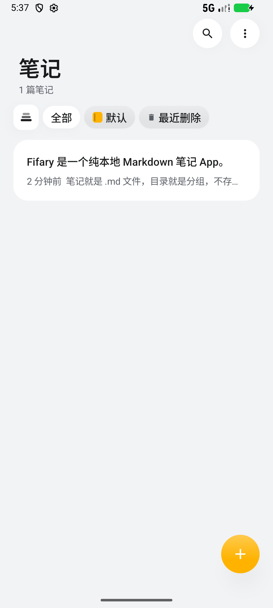
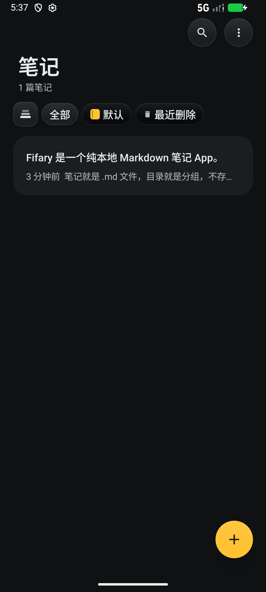
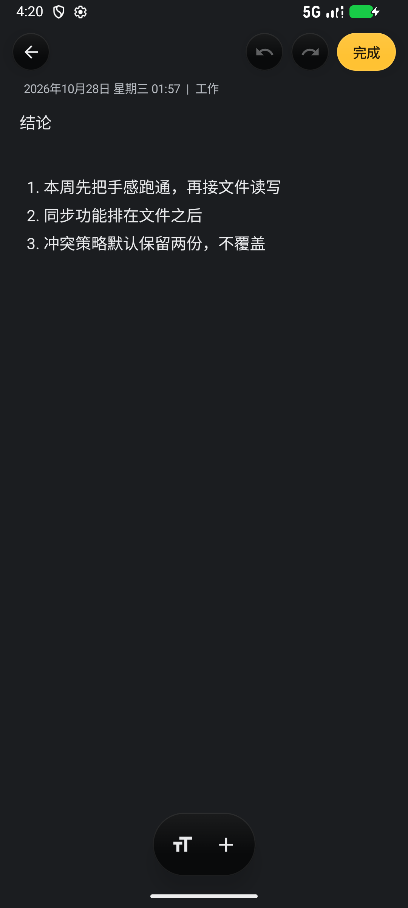
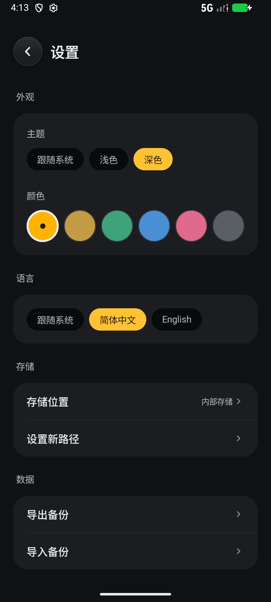

# Fifary

一个纯本地的 Android Markdown 笔记 App。不登录、不上传、不配置服务器也能完整使用；笔记就是硬盘上的 `.md` 文件，目录就是分组。

纯 Kotlin + Jetpack Compose，没有数据库、没有账号体系。

## 截图

| 日间 | 夜间 |
| --- | --- |
|  |  |
|  |  |

## 功能

- **本地 Markdown**：一篇笔记 = 一个 `.md` 文件，文件头的 front matter 记时间/置顶/私密，用别的编辑器打开也不影响
- **分组即目录**：一级目录就是分组，和 Obsidian 一样，改目录结构 App 里立刻跟着变
- **富文本编辑**：标题、加粗、斜体、列表、待办、表格、分割线、图片、录音，存下来还是 Markdown
- **置顶 / 最近删除**：删除进回收站保留 30 天，随时找回
- **私密笔记**：AES-GCM 独立数据密钥，密码只在本机验证，改密码不用重新加密笔记
- **WebDAV 同步**：任意标准 WebDAV（坚果云、Nextcloud、群晖…），可开自动同步，冲突按最后修改时间新者胜，不删远端也不删本地
- **存储位置可选**：内部存储 / 应用外部目录 / 自定义目录（如 `/sdcard/Documents/Fifary`）
- **导入导出**：整库打成一个 zip，换机就是导出再导入
- **深浅色 + 六套配色 + 中英双语**

## 数据在哪

```
vault/
├── 工作/周会记录.md        # 目录 = 分组
├── attachments/            # 图片和录音，跟笔记放一起
└── 咖啡豆.md
```

整个 `vault` 目录拷走就是一次完整备份。设置里的「导出备份」打的就是这个目录。

## 同步怎么做

设置 → 同步数据 → 填 WebDAV 地址、账号、密码。App 只在填的地址下面建一个 `Fifary/` 目录放笔记，不碰你 WebDAV 里的其他文件。上传/下载按文件的最后修改时间比：本地新就传上去，远端新就拉下来，两边都有就谁新听谁的。**不删数据**，远端多出来的文件会被拉回本地。

## 构建

```bash
# JDK 17 + Android SDK 36
./gradlew assembleDebug
```

## 下载

到 [Releases](https://github.com/siwuli/Fifary/releases) 拿 APK。

## License

[MIT](LICENSE)
